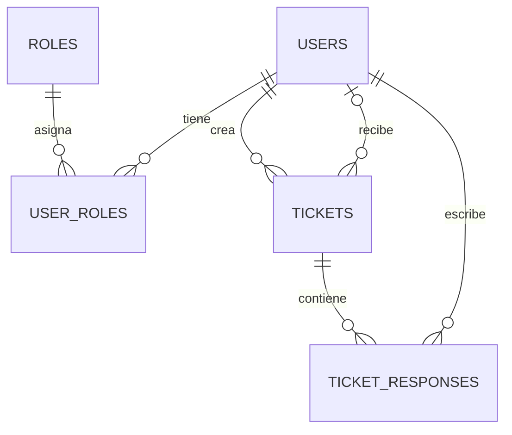

# LAB14PM

LAB 14 CONEXION GITHUB Y RENDER

API de gestión de tickets para trabajar el laboratorio en una solución .NET 8. La estructura toma como referencia la práctica LAB 11: CQRS con MediatR y carpetas para API, Application, Domain e Infrastructure. La guía LAB 14 se centra en publicar .NET 8, automatizar el flujo con GitHub Actions y desplegar el servicio en Render.

## Análisis de la estructura del LAB 11

La guía organiza la solución en cuatro capas. `Domain` concentra entidades y reglas del negocio; `Application` contiene casos de uso, comandos, consultas y handlers CQRS; `Infrastructure` implementa el acceso a MySQL; y `API` expone los endpoints REST y registra los servicios. MediatR enruta comandos de escritura y consultas de lectura hacia sus handlers. El ejemplo documenta un sistema de tickets con usuarios, roles y respuestas, y muestra Swagger para explorar la API.

LAB14PM conserva esa separación en carpetas dentro de un proyecto web para que la solución sea sencilla de abrir en Rider y publicar como una sola aplicación. Incluye CQRS para listar/consultar tickets, crear tickets, cambiar su estado y registrar respuestas.

## Contenido

- `LAB14PM.sln`: solución de Rider/Visual Studio.
- `src/LAB14PM.Api`: API .NET 8, documentación Swagger en desarrollo y health check.
- `database/lab14pm.sql`: esquema, claves foráneas e información de demostración importable desde MySQL Workbench.
- `.github/workflows/dotnet.yml`: build, publicación del artefacto y disparador de despliegue a Render.
- `Dockerfile` y `render.yaml`: configuración de contenedor y servicio Render.

## Ejecutar localmente

1. En MySQL Workbench abre `database/lab14pm.sql` y ejecútalo. Crea la base `lab14pm`, tablas `roles`, `users`, `user_roles`, `tickets` y `ticket_responses`, y algunos registros de ejemplo.
2. La conexión local se define en `src/LAB14PM.Api/appsettings.Local.json`, un archivo ignorado por Git. Se carga solo en entorno Development. En Render se usa `ConnectionStrings__Default`.
3. Abre `LAB14PM.sln` en Rider con .NET 8 SDK instalado y ejecuta el proyecto `LAB14PM.Api`.
4. En desarrollo visita `/swagger`; `/health` devuelve el estado básico del servicio.

Las tablas `users` y `roles` modelan el contexto de la guía LAB 11. Este entregable no implementa autenticación ni autorización; el valor de contraseña insertado es ficticio y no sirve para iniciar sesión.

## Endpoints

- `GET /api/tickets/`
- `GET /api/tickets/{id}`
- `POST /api/tickets/` con `title`, `description`, `createdByUserId` y `assignedToUserId` opcional.
- `PATCH /api/tickets/{id}/status` con `status`: `open`, `in_progress`, `resolved` o `closed`.
- `POST /api/tickets/{id}/responses` con `userId` y `message`.

La base de datos debe estar inicializada y los identificadores de usuario enviados deben existir para cumplir las claves foráneas. Para probar los datos incluidos, el usuario solicitante tiene el ID `11111111-1111-4111-8111-111111111111` y el agente `22222222-2222-4222-8222-222222222222`.

## Publicación según LAB 14

### Publicación manual

Desde la carpeta del proyecto ejecuta `dotnet publish src/LAB14PM.Api/LAB14PM.Api.csproj -c Release -o ./published`. El contenedor Docker también publica la aplicación en modo Release.

### GitHub Actions y Render

1. Sube el proyecto a un repositorio GitHub en la rama `main`.
2. En Render crea un servicio Web usando el Blueprint del archivo `render.yaml` y conecta ese repositorio.
3. En Render configura `ConnectionStrings__Default` con la conexión a un servidor MySQL accesible desde Render. No publiques credenciales dentro del repositorio. Render necesita una base MySQL externa; el esquema SQL se importa en esa instancia antes de iniciar la API.
4. Crea un Deploy Hook para el servicio Render y guárdalo en GitHub como secreto `RENDER_DEPLOY_HOOK_URL`.
5. Cada push a `main` ejecuta restore, build y publish en `.github/workflows/dotnet.yml`; al finalizar, GitHub Actions llama el Deploy Hook para solicitar el despliegue.
6. Verifica `/health` en la URL entregada por Render. Swagger se habilita solo en entorno Development.

## Variables de configuración

- `ConnectionStrings__Default`: cadena de conexión MySQL en Render/GitHub secrets.
- En local se puede modificar la cadena de `appsettings.Development.json`.

No se copiaron instrucciones de las guías como datos de la aplicación: LAB 11 y LAB 14 se usaron como requisitos de estructura y despliegue, respectivamente.

## Modelo de datos

La tabla puente `user_roles` permite que un usuario tenga más de un rol. Las respuestas pertenecen a un ticket y a un usuario. Las claves foráneas evitan tickets sin solicitante y respuestas huérfanas.

## Notas sobre las guías

La guía LAB 11 indica reutilizar una base entregada en LAB 10, pero ese archivo no está entre los adjuntos. Por eso `lab14pm.sql` es un esquema nuevo inferido de las entidades y capturas del PDF (usuarios, roles, tickets y respuestas); si la base del LAB 10 usa otros nombres o columnas, habrá que ajustar el repositorio y el script para mantener compatibilidad. El PDF se titula Laboratorio 11, aunque en los pies aparece “Guía de Laboratorio No 02”; sus observaciones mencionan .NET 9. Para seguir la guía adjunta de LAB 14, este proyecto apunta a .NET 8.

**Compatibilidad del entorno:** al momento de preparar el proyecto, el entorno local solo tenía instalado el SDK .NET 10, así que no ejecuté la compilación de un proyecto cuyo objetivo es `net8.0`. Además, Microsoft marcó .NET 8 fuera de soporte el 10 de noviembre de 2026; se conserva aquí porque así lo exige el material del LAB 14. [Política oficial de soporte de .NET](https://dotnet.microsoft.com/en-us/platform/support/policy/dotnet-core).
